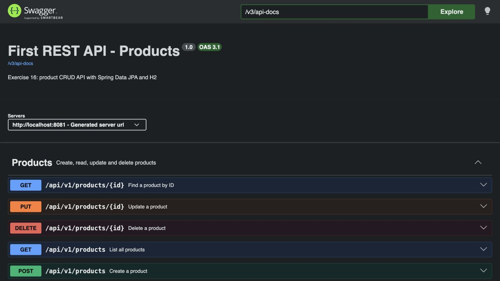
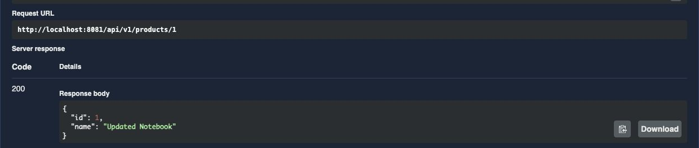
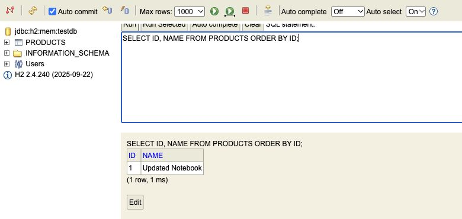
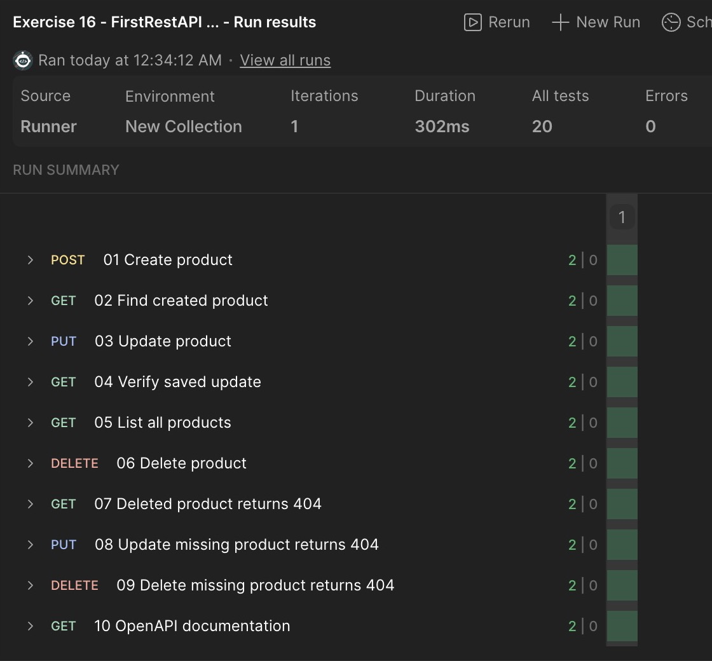

# Task 2 · First REST API

A Spring Boot REST API that creates, reads, updates and deletes products. Each product has a generated numeric ID and a name. The API uses JSON and stores products in an in-memory H2 database. The database starts empty and its contents are lost when the application stops.

## Run locally

Install JDK 21. From the repository root on macOS or Linux:

```sh
cd FirstRestAPI
sh mvnw spring-boot:run
```

On Windows, run `mvnw.cmd spring-boot:run` from the project folder. You can also open the project's `pom.xml` in IntelliJ IDEA and run `FirstRestApiApplication` with JDK 21.

The examples below use port 8080. If Task 1 is already using that port, start this API with `sh mvnw spring-boot:run -Dspring-boot.run.arguments=--server.port=8081`. On Windows use `mvnw.cmd` in place of `sh mvnw`. Replace 8080 with 8081 in the examples and in the Postman collection's `baseUrl`.

## Product endpoints

All routes are relative to `http://localhost:8080`. Send `Content-Type: application/json` with POST and PUT requests.

| Method and path | Purpose | Successful response |
| --- | --- | --- |
| `POST /api/v1/products` | Create a product using a body such as `{"name":"Notebook"}`. | `201 Created` and the product JSON. |
| `GET /api/v1/products` | List all products. | `200 OK` and a JSON array, or `[]` when empty. |
| `GET /api/v1/products/{id}` | Find one product. | `200 OK` and the product JSON. |
| `PUT /api/v1/products/{id}` | Change the product name using a body such as `{"name":"Updated Notebook"}`. | `200 OK` and the updated product JSON. |
| `DELETE /api/v1/products/{id}` | Delete one product. | `204 No Content` with an empty response body. |

The path selects the product for an update. A GET by ID, PUT or DELETE for a missing product returns `404 Not Found` with a JSON message, for example `{"message":"Product with 1 not found"}`.

## Demo in Swagger UI

Open [Swagger UI](http://localhost:8080/swagger-ui/index.html), expand an operation and select **Try it out**. The raw OpenAPI description is available at [`/v3/api-docs`](http://localhost:8080/v3/api-docs).

1. Create a product with POST and `{"name":"Notebook"}`. Note the generated `id` in the `201` response.
2. List the products, then use GET by ID to retrieve the new product.
3. Send PUT with the same ID and `{"name":"Updated Notebook"}`. Retrieve it again to confirm the update.
4. Send DELETE with that ID and verify the `204` response. Repeat GET by ID to see the `404` message.





## Inspect the database with H2

Open the [H2 console](http://localhost:8080/console/). Use JDBC URL `jdbc:h2:mem:testdb`, username `sa` and an empty password. Select **Connect** and run:

```sql
SELECT ID, NAME FROM PRODUCTS ORDER BY ID;
```

Run the query after creating, updating and deleting a product to see the corresponding row appear, change and disappear.



## Run the Postman collection

Import [FirstRestAPI-final.postman_collection.json](postman/FirstRestAPI-final.postman_collection.json) into Postman. Run the requests in order with Collection Runner. The create request saves the returned ID for subsequent requests. The ten requests check CRUD responses, missing-product errors and OpenAPI availability.



## How it works

- `ProductController` exposes the HTTP endpoints and exchanges JSON through request and response DTOs. `ProductMapper` converts between DTOs and the `Product` entity.
- `ProductService` handles product operations within transactions. `ProductRepository` extends `JpaRepository<Product, Long>` and inherits methods such as `save`, `findById`, `findAll` and `deleteById`. Spring Data JPA creates a repository proxy at runtime. Its implementation uses the JPA entity manager and Hibernate to execute database queries, so the standard methods need no custom implementation.
- When an ID cannot be found, the service raises `ProductNotFoundException`. `ProductExceptionAdvisor` turns it into a JSON response with HTTP 404.

## Tools and tests

The project uses Java 21, Spring Boot, Spring MVC, Jackson, Spring Data JPA, Hibernate and H2. Spring Initializr provided the project structure. IntelliJ IDEA and Maven Wrapper were used for development and builds. Springdoc generates the OpenAPI description and serves Swagger UI. Postman runs the request collection.

Run `sh mvnw test` (Windows: `mvnw.cmd test`) from this folder. The Spring Boot and MockMvc tests cover application startup, product operations, missing IDs and the documentation endpoints.
