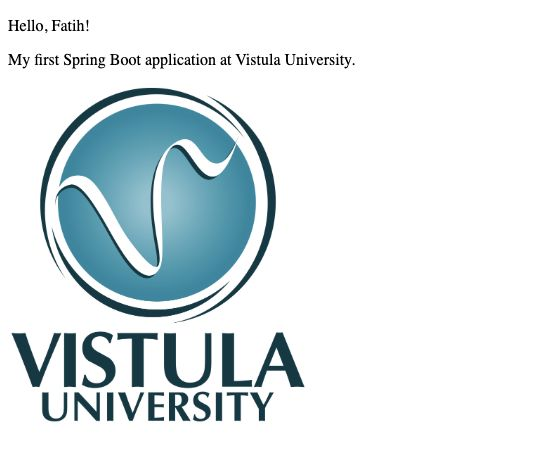

# Task 1 · First Spring App

A Spring MVC application that shows two ways to respond to an HTTP request. The home endpoint returns plain text. The greeting endpoint renders an HTML page using Thymeleaf.

## Run locally

Install JDK 21. From the repository root, run these commands on macOS or Linux:

```sh
cd firstspringapp
sh mvnw spring-boot:run
```

On Windows, run `mvnw.cmd spring-boot:run` from the same folder. In IntelliJ IDEA, you can also open this project's `pom.xml` as a Maven project, select JDK 21, and run `FirstspringappApplication`.

## Try the application

| Browser address | Expected result |
| --- | --- |
| [localhost:8080/](http://localhost:8080/) | `Hello Vistula, in my first Spring controller.` |
| [localhost:8080/greeting](http://localhost:8080/greeting) | `Hello, World!` and the Vistula University logo. |
| [localhost:8080/greeting?name=Fatih](http://localhost:8080/greeting?name=Fatih) | `Hello, Fatih!` and the logo. Replace `Fatih` with another name to personalize the page. |

### Plain-text response


### Personalized greeting



## How it works

- [HelloController](src/main/java/pl/edu/vistula/firstspringapp/controller/HelloController.java) uses `@ResponseBody` to send the home message directly. For `/greeting`, it reads the optional `name` query parameter, defaults it to `World`, and puts it in the Spring MVC model.
- [greeting.html](src/main/resources/templates/greeting.html) renders the model value and references the logo under `src/main/resources/static/images`. Spring Boot serves the image at `/images/vistula.png`.

## Tools and tests

The project uses Java 21, Spring Boot, Spring MVC and Thymeleaf. Spring Initializr provided the project structure. IntelliJ IDEA was used for development, and Maven Wrapper builds and runs the project. Lombok is included in the build configuration.

Run `sh mvnw test` (Windows: `mvnw.cmd test`) to check that the Spring application context starts. Use the browser addresses above to verify the responses.
